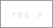
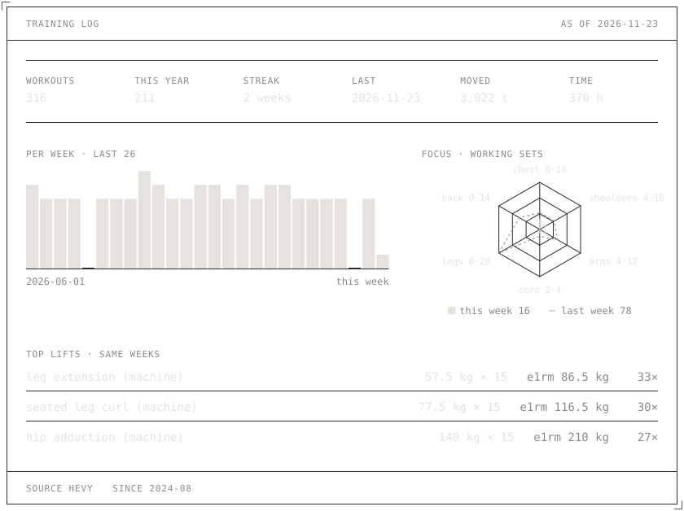

<!-- Generated by scripts/build.py from goksen.ing. Edit the site, not this file. -->
<a href="https://goksen.ing"><picture><source media="(prefers-color-scheme: dark)" srcset="assets/identity-dark.svg"><source media="(prefers-color-scheme: light)" srcset="assets/identity-light.svg"></picture></a>

<a href="https://goksen.ing"><picture><source media="(prefers-color-scheme: dark)" srcset="assets/button-open-dark.svg"><source media="(prefers-color-scheme: light)" srcset="assets/button-open-light.svg"></picture></a> <a href="mailto:me@goksen.ing"><picture><source media="(prefers-color-scheme: dark)" srcset="assets/button-mail-dark.svg"><source media="(prefers-color-scheme: light)" srcset="assets/button-mail-light.svg"></picture></a> <a href="https://www.linkedin.com/in/gokseningungor"><picture><source media="(prefers-color-scheme: dark)" srcset="assets/button-linkedin-dark.svg"><source media="(prefers-color-scheme: light)" srcset="assets/button-linkedin-light.svg"></picture></a> <a href="https://goksen.ing/feed.xml"><picture><source media="(prefers-color-scheme: dark)" srcset="assets/button-rss-dark.svg"><source media="(prefers-color-scheme: light)" srcset="assets/button-rss-light.svg"></picture></a>

<picture><source media="(prefers-color-scheme: dark)" srcset="assets/index-head-dark.svg"><source media="(prefers-color-scheme: light)" srcset="assets/index-head-light.svg"></picture> <a href="https://goksen.ing/writing"><picture><source media="(prefers-color-scheme: dark)" srcset="assets/row-writing-dark.svg"><source media="(prefers-color-scheme: light)" srcset="assets/row-writing-light.svg"></picture></a> <a href="https://goksen.ing/writing/500-icons-two-inks"><picture><source media="(prefers-color-scheme: dark)" srcset="assets/row-writing-500-icons-two-inks-dark.svg"><source media="(prefers-color-scheme: light)" srcset="assets/row-writing-500-icons-two-inks-light.svg"></picture></a> <a href="https://goksen.ing/writing/a-map-of-where-i-shot"><picture><source media="(prefers-color-scheme: dark)" srcset="assets/row-writing-a-map-of-where-i-shot-dark.svg"><source media="(prefers-color-scheme: light)" srcset="assets/row-writing-a-map-of-where-i-shot-light.svg"></picture></a> <a href="https://goksen.ing/writing/a-requirements-document-that-says-no"><picture><source media="(prefers-color-scheme: dark)" srcset="assets/row-writing-a-requirements-document-that-says-no-dark.svg"><source media="(prefers-color-scheme: light)" srcset="assets/row-writing-a-requirements-document-that-says-no-light.svg"></picture></a> <a href="https://goksen.ing/writing"><picture><source media="(prefers-color-scheme: dark)" srcset="assets/row-writing-more-dark.svg"><source media="(prefers-color-scheme: light)" srcset="assets/row-writing-more-light.svg"></picture></a> <a href="https://goksen.ing/work"><picture><source media="(prefers-color-scheme: dark)" srcset="assets/row-work-dark.svg"><source media="(prefers-color-scheme: light)" srcset="assets/row-work-light.svg"></picture></a> <a href="https://goksen.ing/work/resync"><picture><source media="(prefers-color-scheme: dark)" srcset="assets/row-work-resync-dark.svg"><source media="(prefers-color-scheme: light)" srcset="assets/row-work-resync-light.svg"></picture></a> <a href="https://goksen.ing/work/terminal-home"><picture><source media="(prefers-color-scheme: dark)" srcset="assets/row-work-terminal-home-dark.svg"><source media="(prefers-color-scheme: light)" srcset="assets/row-work-terminal-home-light.svg"></picture></a> <a href="https://goksen.ing/work/durandal"><picture><source media="(prefers-color-scheme: dark)" srcset="assets/row-work-durandal-dark.svg"><source media="(prefers-color-scheme: light)" srcset="assets/row-work-durandal-light.svg"></picture></a> <a href="https://goksen.ing/work"><picture><source media="(prefers-color-scheme: dark)" srcset="assets/row-work-more-dark.svg"><source media="(prefers-color-scheme: light)" srcset="assets/row-work-more-light.svg"></picture></a> <a href="https://goksen.ing/lab"><picture><source media="(prefers-color-scheme: dark)" srcset="assets/row-lab-dark.svg"><source media="(prefers-color-scheme: light)" srcset="assets/row-lab-light.svg"></picture></a> <a href="https://goksen.ing/lab/found-objects"><picture><source media="(prefers-color-scheme: dark)" srcset="assets/row-lab-found-objects-dark.svg"><source media="(prefers-color-scheme: light)" srcset="assets/row-lab-found-objects-light.svg"></picture></a> <a href="https://goksen.ing/lab/aftershock"><picture><source media="(prefers-color-scheme: dark)" srcset="assets/row-lab-aftershock-dark.svg"><source media="(prefers-color-scheme: light)" srcset="assets/row-lab-aftershock-light.svg"></picture></a> <a href="https://goksen.ing/lab/background-process"><picture><source media="(prefers-color-scheme: dark)" srcset="assets/row-lab-background-process-dark.svg"><source media="(prefers-color-scheme: light)" srcset="assets/row-lab-background-process-light.svg"></picture></a> <a href="https://goksen.ing/lab"><picture><source media="(prefers-color-scheme: dark)" srcset="assets/row-lab-more-dark.svg"><source media="(prefers-color-scheme: light)" srcset="assets/row-lab-more-light.svg"></picture></a> <a href="https://goksen.ing/about"><picture><source media="(prefers-color-scheme: dark)" srcset="assets/row-page-about-dark.svg"><source media="(prefers-color-scheme: light)" srcset="assets/row-page-about-light.svg"></picture></a> <a href="https://goksen.ing/system"><picture><source media="(prefers-color-scheme: dark)" srcset="assets/row-page-system-dark.svg"><source media="(prefers-color-scheme: light)" srcset="assets/row-page-system-light.svg"></picture></a> <a href="https://goksen.ing/feed.xml"><picture><source media="(prefers-color-scheme: dark)" srcset="assets/row-page-feed-xml-dark.svg"><source media="(prefers-color-scheme: light)" srcset="assets/row-page-feed-xml-light.svg"></picture></a> <picture><source media="(prefers-color-scheme: dark)" srcset="assets/index-foot-dark.svg"><source media="(prefers-color-scheme: light)" srcset="assets/index-foot-light.svg"></picture>

<a href="https://goksen.ing"><picture><source media="(prefers-color-scheme: dark)" srcset="assets/training-dark.svg"><source media="(prefers-color-scheme: light)" srcset="assets/training-light.svg"></picture></a>

Drawn from the <a href="https://goksen.ing/system">goksen.ing design system</a> by <code>scripts/build.py</code>; it rebuilds from the site every day.
