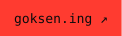
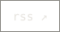
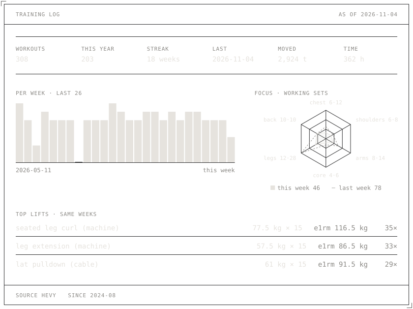

<!-- Generated by scripts/build.py from goksen.ing. Edit the site, not this file. -->
<a href="https://goksen.ing"><picture><source media="(prefers-color-scheme: dark)" srcset="assets/identity-dark.svg"><source media="(prefers-color-scheme: light)" srcset="assets/identity-light.svg"></picture></a>

<a href="https://goksen.ing"><picture><source media="(prefers-color-scheme: dark)" srcset="assets/button-open-dark.svg"><source media="(prefers-color-scheme: light)" srcset="assets/button-open-light.svg"></picture></a> <a href="mailto:me@goksen.ing"><picture><source media="(prefers-color-scheme: dark)" srcset="assets/button-mail-dark.svg"><source media="(prefers-color-scheme: light)" srcset="assets/button-mail-light.svg"></picture></a> <a href="https://www.linkedin.com/in/gokseningungor"><picture><source media="(prefers-color-scheme: dark)" srcset="assets/button-linkedin-dark.svg"><source media="(prefers-color-scheme: light)" srcset="assets/button-linkedin-light.svg"></picture></a> <a href="https://goksen.ing/feed.xml"><picture><source media="(prefers-color-scheme: dark)" srcset="assets/button-rss-dark.svg"><source media="(prefers-color-scheme: light)" srcset="assets/button-rss-light.svg"></picture></a>

<picture><source media="(prefers-color-scheme: dark)" srcset="assets/index-head-dark.svg"><source media="(prefers-color-scheme: light)" srcset="assets/index-head-light.svg"></picture> <a href="https://goksen.ing/writing"><picture><source media="(prefers-color-scheme: dark)" srcset="assets/row-writing-dark.svg"><source media="(prefers-color-scheme: light)" srcset="assets/row-writing-light.svg"></picture></a> <a href="https://goksen.ing/writing/something-about-ai"><picture><source media="(prefers-color-scheme: dark)" srcset="assets/row-writing-something-about-ai-dark.svg"><source media="(prefers-color-scheme: light)" srcset="assets/row-writing-something-about-ai-light.svg"></picture></a> <a href="https://goksen.ing/writing/text-x-component"><picture><source media="(prefers-color-scheme: dark)" srcset="assets/row-writing-text-x-component-dark.svg"><source media="(prefers-color-scheme: light)" srcset="assets/row-writing-text-x-component-light.svg"></picture></a> <a href="https://goksen.ing/work"><picture><source media="(prefers-color-scheme: dark)" srcset="assets/row-work-dark.svg"><source media="(prefers-color-scheme: light)" srcset="assets/row-work-light.svg"></picture></a> <a href="https://goksen.ing/work/afet-harita"><picture><source media="(prefers-color-scheme: dark)" srcset="assets/row-work-afet-harita-dark.svg"><source media="(prefers-color-scheme: light)" srcset="assets/row-work-afet-harita-light.svg"></picture></a> <a href="https://goksen.ing/lab"><picture><source media="(prefers-color-scheme: dark)" srcset="assets/row-lab-dark.svg"><source media="(prefers-color-scheme: light)" srcset="assets/row-lab-light.svg"></picture></a> <a href="https://goksen.ing/lab/aftershock"><picture><source media="(prefers-color-scheme: dark)" srcset="assets/row-lab-aftershock-dark.svg"><source media="(prefers-color-scheme: light)" srcset="assets/row-lab-aftershock-light.svg"></picture></a> <a href="https://goksen.ing/lab/background-process"><picture><source media="(prefers-color-scheme: dark)" srcset="assets/row-lab-background-process-dark.svg"><source media="(prefers-color-scheme: light)" srcset="assets/row-lab-background-process-light.svg"></picture></a> <a href="https://goksen.ing/lab/majority-shell"><picture><source media="(prefers-color-scheme: dark)" srcset="assets/row-lab-majority-shell-dark.svg"><source media="(prefers-color-scheme: light)" srcset="assets/row-lab-majority-shell-light.svg"></picture></a> <a href="https://goksen.ing/lab"><picture><source media="(prefers-color-scheme: dark)" srcset="assets/row-lab-more-dark.svg"><source media="(prefers-color-scheme: light)" srcset="assets/row-lab-more-light.svg"></picture></a> <a href="https://goksen.ing/about"><picture><source media="(prefers-color-scheme: dark)" srcset="assets/row-page-about-dark.svg"><source media="(prefers-color-scheme: light)" srcset="assets/row-page-about-light.svg"></picture></a> <a href="https://goksen.ing/system"><picture><source media="(prefers-color-scheme: dark)" srcset="assets/row-page-system-dark.svg"><source media="(prefers-color-scheme: light)" srcset="assets/row-page-system-light.svg"></picture></a> <a href="https://goksen.ing/feed.xml"><picture><source media="(prefers-color-scheme: dark)" srcset="assets/row-page-feed-xml-dark.svg"><source media="(prefers-color-scheme: light)" srcset="assets/row-page-feed-xml-light.svg"></picture></a> <picture><source media="(prefers-color-scheme: dark)" srcset="assets/index-foot-dark.svg"><source media="(prefers-color-scheme: light)" srcset="assets/index-foot-light.svg"></picture>

<a href="https://goksen.ing"><picture><source media="(prefers-color-scheme: dark)" srcset="assets/training-dark.svg"><source media="(prefers-color-scheme: light)" srcset="assets/training-light.svg"></picture></a>

Drawn from the <a href="https://goksen.ing/system">goksen.ing design system</a> by <code>scripts/build.py</code>; it rebuilds from the site every day.
